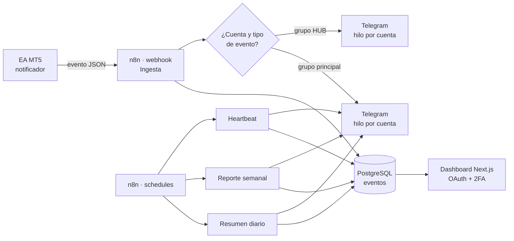

# Monitoreo MT5 con n8n: telemetría de cuentas de trading en tiempo real, sin revisarlas a mano

**Problema.** Para saber qué pasaba en varias cuentas MT5 había que abrir cada terminal. No había historial centralizado, ni alertas cuando un terminal se caía, ni reportes periódicos por cuenta.

**Solución.** Un Expert Advisor publica cada evento de la cuenta en un webhook de n8n. n8n lo persiste en PostgreSQL y lo envía a Telegram, en grupos con un hilo por cuenta. Workflows programados generan resúmenes diarios y semanales y vigilan el latido de cada terminal. Un dashboard web con login seguro muestra el estado consolidado.

**Stack.** MQL5 · n8n · PostgreSQL · Telegram Bot API · Next.js 14 · NextAuth (Google OAuth) + TOTP · Docker/Coolify · Cloudflare

**Mi rol.** Diseñé el flujo de punta a punta: el contrato del evento del EA, el esquema SQL, la lógica de enrutamiento a grupos e hilos y el dashboard. Delegué a la IA la escritura de los nodos Code y parte del frontend. Validé con scripts de verificación de producción y con un registro de logros por fase.

**Resultados.**
- 4 workflows en producción: ingesta, resumen diario, reporte semanal y heartbeat. <!-- fuente: WOS/_reports/INVENTARIO_STACK_2026-10.md §4 -->
- ~2,4 M de registros de telemetría en PostgreSQL. <!-- fuente: WOS/_reports/INVENTARIO_STACK_2026-10.md §3.9 (HETZNER_CRITICALITY_MAP.md) -->
- Dashboard con Google OAuth + 2FA TOTP, auto-refresco de 30 s y despliegue con Docker en Coolify. <!-- fuente: WOS/_reports/INVENTARIO_STACK_2026-10.md §3.9 -->
- 70 commits en el repo del dashboard (2026-01-23 → 2026-04-16). <!-- fuente: WOS/_reports/INVENTARIO_STACK_2026-10.md §3.9 -->
- Ingesta sin duplicados en la auditoría posterior a la migración. <!-- fuente: WOS/_reports/INVENTARIO_STACK_2026-10.md §3.10 (FINAL_DEX_HETZNER_CANCELLATION_REAUDIT.md) -->

## Arquitectura

## Decisiones clave
- **PostgreSQL como fuente de verdad, Telegram como vista**: los reportes se recalculan desde la base, así que un mensaje perdido no pierde datos.
- **Grupos con hilos por cuenta en vez de un canal por cuenta**: escala de 6 a 9 cuentas sin crear canales nuevos y reduce el ruido. <!-- fuente: WOS/_reports/INVENTARIO_STACK_2026-10.md §3.9 -->
- **Heartbeat separado de la ingesta**: detecta el silencio de un terminal, que la ingesta por eventos nunca vería.

## Qué haría distinto
Agregaría desde el día uno tests automáticos de los workflows (fixtures de eventos) en lugar de verificar solo con scripts contra producción.

## Capturas
Sistema interno (n8n, Telegram y dashboard con login): se ilustra solo con el diagrama.

> Código privado. Recorrido técnico disponible a pedido.
