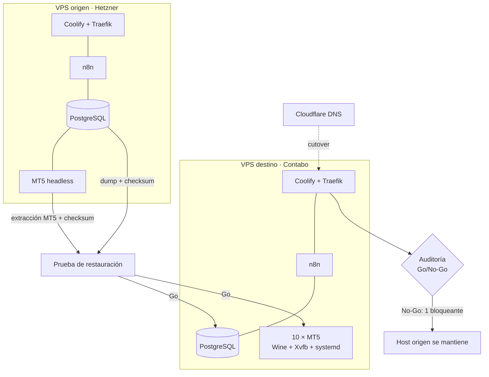

# Migración Hetzner → Contabo: mover un host de trading en vivo con fases, checksums y Go/No-Go

**Problema.** El host de trading (Coolify, n8n, PostgreSQL, Docker y varias instancias MT5 headless) se había quedado chico en el VPS de origen. Había que mudarlo sin perder datos ni dejar las cuentas sin monitoreo.

**Solución.** Una migración por fases, con respaldos verificados por checksum, pruebas de restauración antes del corte, cutover DNS planificado, traspaso instancia por instancia y una auditoría Go/No-Go final antes de cancelar el host viejo.

**Stack.** Coolify + Traefik · Docker · PostgreSQL · n8n 2.6 · MT5 bajo Wine + Xvfb · systemd · Cloudflare DNS · cron + flock

**Mi rol.** Definí las fases, los criterios de salida de cada una y el plan de rollback. Usé Claude Code, Codex y Antigravity como ejecutores y auditores cruzados: cada fase dejó un informe con evidencia. Tomé cada decisión Go/No-Go con base en esos informes.

**Resultados.**
- 10 instancias MT5 headless operando en el host nuevo. <!-- fuente: WOS/_reports/INVENTARIO_STACK_2026-10.md §3.10 -->
- 5/5 checksums de backup verificados y 0 duplicados en la ingesta posterior. <!-- fuente: WOS/_reports/INVENTARIO_STACK_2026-10.md §3.10 (FINAL_DEX_HETZNER_CANCELLATION_REAUDIT.md) -->
- 184 informes técnicos organizados por fase (174 de Claude, 8 de Antigravity y 2 de Codex). <!-- fuente: WOS/_reports/INVENTARIO_STACK_2026-10.md §3.10 -->
- Cutover DNS el 2026-07-26 y traspaso de instancias el 27 y 28 de julio. <!-- fuente: WOS/_reports/INVENTARIO_STACK_2026-10.md §3.10 -->
- La auditoría final bloqueó la cancelación del host viejo por un único riesgo detectado (un lanzador que detenía todas las instancias): el No-Go funcionó como estaba previsto. <!-- fuente: WOS/_reports/INVENTARIO_STACK_2026-10.md §3.10 -->

## Arquitectura

**Fases:** día 1–3 (inventario y respaldos) → restore A/B/C (pruebas de restauración) → pre-cutover → cutover DNS → ciclos D/E (traspaso por instancia) → fase F (estabilización) → auditoría de cancelación.

## Decisiones clave
- **Restaurar antes de cortar**: un backup solo cuenta si se restauró y se comparó su checksum; por eso hubo tres rondas de restore antes del cutover.
- **Traspaso instancia por instancia**: limita el impacto de un fallo a una sola cuenta y permite volver atrás con poco costo.
- **Un Go/No-Go explícito para cancelar el origen**: cancelar es irreversible, así que se exigió una auditoría independiente; detectó un bloqueante real.

## Qué haría distinto
Automatizaría la recolección de evidencia (checksums, estado de servicios) en un solo script para generar menos informes manuales y más comparables entre fases.

## Capturas
Infraestructura interna: se ilustra solo con el diagrama.

> Código privado. Recorrido técnico disponible a pedido.
