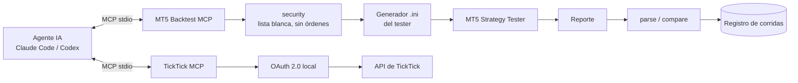

# Servidores MCP propios: darle herramientas seguras a los agentes de IA (backtesting MT5 y TickTick)

**Problema.** Correr backtests de MT5 y gestionar tareas eran pasos manuales que cortaban el trabajo de los agentes de IA: había que compilar, lanzar el tester, leer el reporte y copiar los resultados a mano.

**Solución.** Dos servidores MCP (Model Context Protocol) que exponen esas acciones como herramientas tipadas. El de MT5 compila EAs, corre backtests individuales o por lotes y compara reportes, y por diseño **no puede enviar órdenes reales**. El de TickTick crea, actualiza y completa tareas con OAuth 2.0.

**Stack.** Python · TypeScript · MCP SDK · zod · MT5 Strategy Tester · OAuth 2.0 · pytest

**Mi rol.** Definí el contrato de cada herramienta, el modelo de seguridad (lista blanca de acciones, sin envío de órdenes) y los límites de la API. Delegué a la IA la implementación siguiendo un prompt maestro y validé con tests y con corridas reales registradas.

**Resultados.**
- MT5 Backtest MCP: 8 herramientas, 11 módulos con un módulo de seguridad dedicado y 20 tests. <!-- fuente: WOS/_reports/INVENTARIO_STACK_2026-10.md §3.12 -->
- 78 corridas de backtest registradas con el MCP (individuales, por lotes, eventos y matrices). <!-- fuente: WOS/_reports/INVENTARIO_STACK_2026-10.md §3.12 -->
- Garantía de solo backtest: el código no contiene envío de órdenes. <!-- fuente: WOS/_reports/INVENTARIO_STACK_2026-10.md §3.12 (README del MCP) -->
- TickTick MCP: 15 herramientas con OAuth 2.0 local y 8 documentos (seguridad, límites de la API y catálogo de herramientas). <!-- fuente: WOS/_reports/INVENTARIO_STACK_2026-10.md §3.12 -->

### Herramientas

| MT5 Backtest MCP (Python) | TickTick MCP (TypeScript) |
|---|---|
| `compile_ea` | `ticktick_get_user` · `ticktick_list_projects` · `ticktick_get_project` |
| `run_backtest` | `ticktick_get_project_data` · `ticktick_create_project` |
| `run_batch_backtest` | `ticktick_update_project` · `ticktick_delete_project` |
| `parse_report` | `ticktick_list_tasks` · `ticktick_get_task` · `ticktick_create_task` |
| `compare_backtests` | `ticktick_update_task` · `ticktick_complete_task` · `ticktick_delete_task` |
| `list_runs` · `get_run` | `ticktick_bulk_create_tasks_preview` |
| `extract_run_events` | `ticktick_bulk_create_tasks` |

<!-- fuente: WOS/_reports/INVENTARIO_STACK_2026-10.md §3.12; WOS/dev_tools/mcp-skill-ticktick/docs/MCP_TOOLS.md -->

## Arquitectura



Pseudocódigo del guardián de seguridad:

```text
al recibir herramienta(nombre, args):
  si nombre no está en LISTA_BLANCA: rechazar
  si args piden modo distinto de "tester": rechazar
  ejecutar en el tester y registrar la corrida
```

## Decisiones clave
- **Seguridad por construcción, no por configuración**: el MCP de MT5 no incluye ninguna ruta de código que envíe órdenes, así que un agente no puede operar aunque se equivoque.
- **Vista previa antes de la creación masiva**: `bulk_create_tasks_preview` muestra qué se va a crear antes de escribir en la cuenta real.
- **Corridas registradas como artefactos**: cada backtest deja eventos y diario, así se puede auditar y comparar sin repetir la corrida.

## Qué haría distinto
Publicaría el MCP de TickTick como paquete con su suite de tests propia; hoy es un prototipo funcional sin tests.

## Capturas
Herramientas de uso local: se ilustran solo con el diagrama.

> Código privado. Recorrido técnico disponible a pedido.
