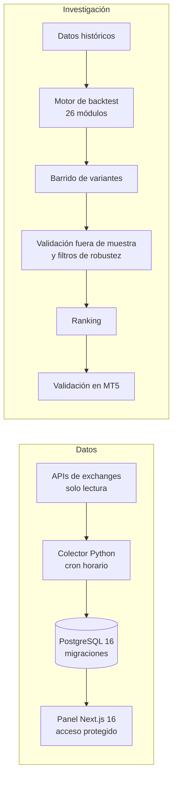
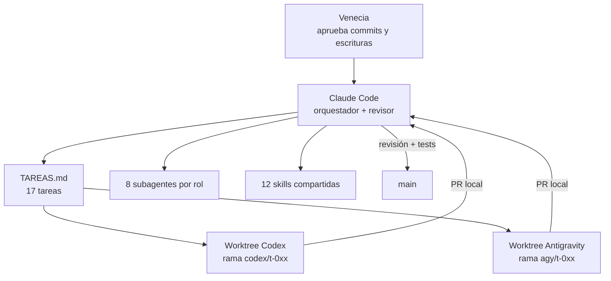

# Logicore + orquestación multiagente: plataforma de inversión automatizada construida con un equipo de agentes de IA

**Problema.** La operación cripto y la investigación de estrategias estaban dispersas en hojas, terminales y archivos sueltos. No había un panel único de cartera ni una forma reproducible de validar estrategias antes de usarlas con capital.

**Solución.** Un colector en Python consulta los exchanges cada hora y guarda la cartera en PostgreSQL 16; un panel Next.js 16 la muestra. En paralelo, un motor de backtest en Python evalúa miles de variantes con validación fuera de muestra. Todo se construyó orquestando a Claude Code, Codex y Antigravity sobre git worktrees, con un tablero de tareas compartido.

**Stack.** Python 3.12 · PostgreSQL 16 · Next.js 16 + React 19 · Tailwind 4 · Docker + Coolify · Vitest + Playwright · pytest · Claude Code / Codex / Antigravity

**Mi rol.** Diseñé la arquitectura, la metodología de validación y el sistema de trabajo multiagente: roles, skills, reglas de aprobación y tablero de tareas. Claude Code orquesta y revisa; Codex y Antigravity implementan en worktrees separados. Yo apruebo cada commit, compra y escritura en exchanges.

**Resultados.**
- Motor de backtest con 26 módulos Python y 189 funciones de test. <!-- fuente: WOS/_reports/INVENTARIO_STACK_2026-10.md §3.1 -->
- 2.536 variantes evaluadas (10 estrategias, 21 combinaciones de estrategia y mercado, 2022–2026) con corte fuera de muestra. <!-- fuente: WOS/_reports/INVENTARIO_STACK_2026-10.md §3.1 (INFORME_2026-10-23.md §3) -->
- 8 subagentes con rol propio, 12 skills espejadas para dos herramientas de IA y un tablero de 17 tareas (12 integradas). <!-- fuente: WOS/_reports/INVENTARIO_STACK_2026-10.md §5 -->
- 91 commits en 13 días (2026-10-15 → 2026-10-27). <!-- fuente: WOS/_reports/INVENTARIO_STACK_2026-10.md §3.1 -->
- Despliegue de 3 servicios (base, colector y web) con un compose para Coolify. <!-- fuente: WOS/_reports/INVENTARIO_STACK_2026-10.md §3.1 -->

## Arquitectura

Roles de los subagentes: operador cripto, diseñador de plataforma, riesgo de cartera, especialista de mercado, ingeniero de backtest, ingeniero de ejecución, investigador quant y revisor. <!-- fuente: WOS/_reports/INVENTARIO_STACK_2026-10.md §5 -->

## Decisiones clave
- **Validación fuera de muestra obligatoria**: una variante solo pasa si se sostiene en un período que el optimizador no vio; así se evita elegir ruido.
- **Un worktree por agente**: cada IA trabaja en su rama sin pisar a las otras, y la integración pasa siempre por revisión y tests.
- **Humano en el circuito para lo irreversible**: commits, compras y escrituras en exchanges requieren aprobación explícita de la dueña.

## Qué haría distinto
Unificaría el conteo de pruebas en CI desde el inicio (hoy los informes y el conteo estático difieren) para que la métrica de calidad tenga una sola fuente.

## Capturas
Panel con acceso privado: se ilustra solo con los diagramas. No se publican parámetros de estrategias, saldos ni identificadores.

> Código privado. Recorrido técnico disponible a pedido.
