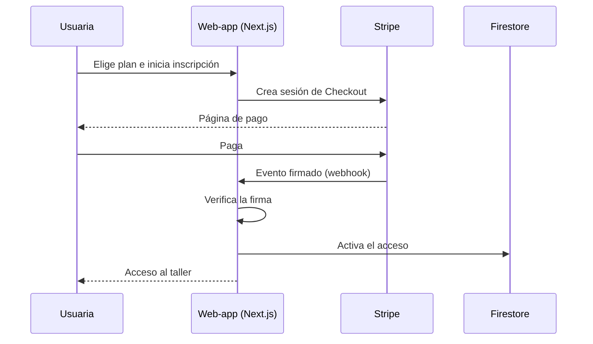
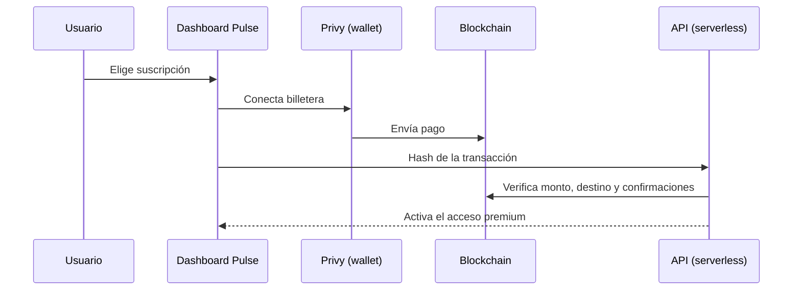
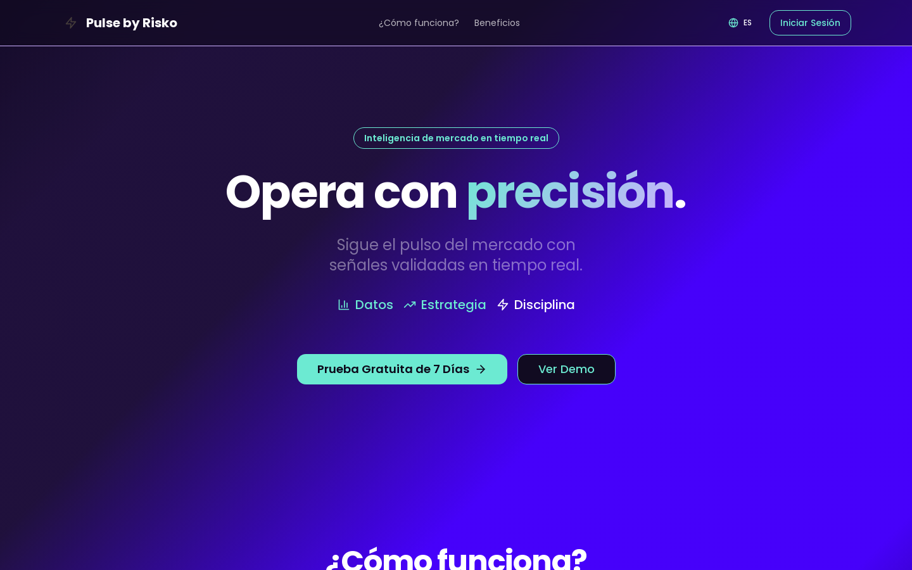
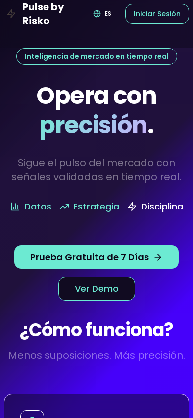

# Pagos: Stripe en producción y flujo de pago Web3 con verificación on-chain

**Problema.** Dos productos necesitaban cobrar y dar acceso automáticamente: una web-app educativa (el_espacio), donde la inscripción se confirmaba a mano, y un producto de señales (Risko Pulse), que quería cobrar con billetera cripto.

**Solución.** En el_espacio: Stripe Checkout → webhook con verificación de firma → activación del acceso, con scripts end-to-end que simulan cada evento. En Pulse: un flujo "wallet-first" con Privy y ethers, en el que el backend verifica la transacción on-chain antes de activar la suscripción.

**Stack.** Stripe · Next.js 15 · Firebase / Firestore · Privy · ethers v6 · Vercel Functions · Supabase · TypeScript

**Mi rol.** Diseñé ambos flujos de pago y sus estados (pago completado, fallido, reembolsado, suscripción cambiada o cancelada) y los scripts de prueba. Delegué a la IA el código de integración y lo validé con los scripts e2e y con revisiones del webhook por release candidate.

**Resultados.**
- Stripe en modo live en el_espacio, sitio en línea. <!-- fuente: WOS/_reports/INVENTARIO_STACK_2026-10.md §3.8 (modo live confirmado por la dueña el 2026-10-28; sitio HTTP 200) -->
- Webhook con verificación de firma de Stripe. <!-- fuente: WOS/_reports/INVENTARIO_STACK_2026-10.md §3.8 -->
- 8 tipos de evento de Stripe cubiertos por scripts e2e y de smoke test (checkout, factura pagada o fallida, reembolso, cambios de suscripción, pagos asíncronos). <!-- fuente: WOS/_reports/INVENTARIO_STACK_2026-10.md §3.8 -->
- Pulse: flujo de pago con billetera **implementado** (Privy + ethers 6, verificación on-chain), no en producción. <!-- fuente: WOS/_reports/INVENTARIO_STACK_2026-10.md §3.2 y §6 -->

## Arquitectura





Pseudocódigo de la verificación on-chain:

```text
tx = leer_transaccion(hash)
si tx.destino != billetera_del_producto: rechazar
si tx.monto < precio_del_plan o tx.confirmaciones < mínimo: rechazar
activar_suscripción(usuario, plan)
```

## Decisiones clave
- **El webhook es la fuente de verdad, no la redirección del navegador**: el acceso se activa solo cuando llega un evento firmado, así una pestaña cerrada no deja un pago sin acceso ni un acceso sin pago.
- **Scripts e2e por evento**: cada caso (reembolso, pago fallido, cancelación) se puede reproducir antes de cada release.
- **Verificación on-chain del lado del servidor**: el cliente solo informa el hash; quien decide es el backend.

## Qué haría distinto
Agregaría idempotencia explícita por ID de evento y un panel de conciliación entre Stripe y la base desde la primera versión.

## Capturas



> Código privado. Recorrido técnico disponible a pedido.
