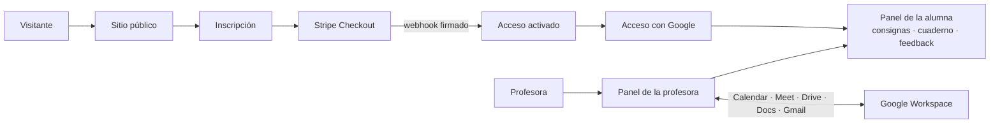

# el_espacio: de clases por Meet y correcciones en Word a un estudio editorial propio

**En línea:** [www.elespaciolugar.com](https://www.elespaciolugar.com) (sitio público, inscripción con pago y paneles de profesora y alumna) · publicado con autorización de la clienta.

## El problema
Una editora y docente de literatura en España da talleres de poesía y narrativa para unas 36 alumnas, en grupos de 6 a 8 personas y en tres horarios. Su operación era manual:
- armaba cada consigna a mano;
- la enviaba por correo, con una fecha de Meet para el encuentro;
- recibía los textos en Word, mail por mail, y devolvía sus correcciones por el mismo camino.

Todo dependía de su bandeja de entrada, y la experiencia no reflejaba el nivel de su trabajo.

## La propuesta
Un producto editorial propio, no una plataforma educativa genérica. Es el único espacio de su tipo **sin clases enlatadas**: un lugar donde cada alumna escribe sus consignas, conversa con la profesora y recibe la devolución en el mismo sitio.

| Pieza | Estado |
|---|---|
| **Sitio público** con identidad editorial: el taller, la profesora y los espacios | En línea |
| **Inscripción con pago integrado** (Stripe, modo live): checkout → webhook con firma verificada → acceso activado | En línea |
| **Panel de la profesora**, conectado a **Google Workspace** (Calendar, Meet, Drive, Docs y Gmail): los encuentros, las consignas y los documentos se crean y sincronizan solos | En línea |
| **Panel de cada alumna**: consignas editables, encuentros, cuaderno de escritura, biblioteca y feedback de la profesora en el mismo lugar | En línea |

## Mi rol
Producto y UX/UI de punta a punta, y desarrollo asistido por IA:
- entendí cómo trabajaba la profesora y lo traduje a flujos y pantallas;
- definí la arquitectura de información y el tono visual: ritmo, tipografía y espacio en blanco de libro;
- diseñé la automatización con Google para eliminar el ir y venir de correos;
- itero por fases con la clienta, en ramas dedicadas para cada ronda de ajustes, y valido cada versión con checklists de QA y scripts de pago end-to-end.

## Stack
Next.js 15 · React 19 · TypeScript · Tailwind CSS · Firebase / Firestore · Google Workspace APIs · Stripe · Resend · Vercel

## Resultados hasta hoy
- Producto completo en línea: sitio, inscripción con Stripe en modo live y paneles de profesora y alumna conectados a Google Workspace.
- En curso: ajustes finales de textos con la clienta.
- Producto pensado para unas 36 alumnas en 3 horarios, sin que la profesora tenga que cambiar de herramienta.
- 85 commits entre mayo y octubre de 2026, en iteraciones por fases con la clienta.

## Por qué importa
Las plataformas educativas genéricas resuelven la logística, pero no la experiencia. Este producto convierte un servicio artesanal en una plataforma escalable sin perder el tono que lo hace único. Es el mismo trabajo que pide cualquier empresa al digitalizar un proceso: entender cómo trabaja la gente, automatizar lo repetitivo y cuidar la experiencia de quien lo usa.

## Arquitectura

## Capturas

> Código privado. Recorrido técnico disponible a pedido.
