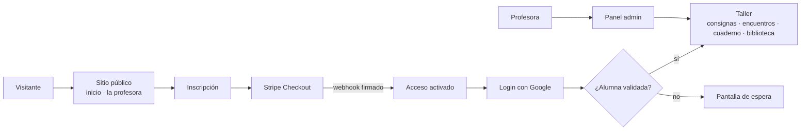
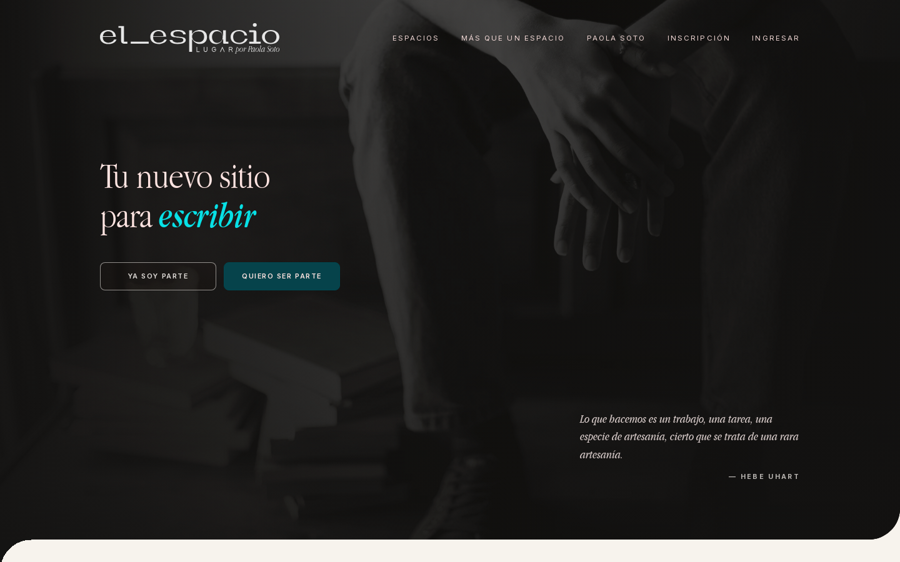
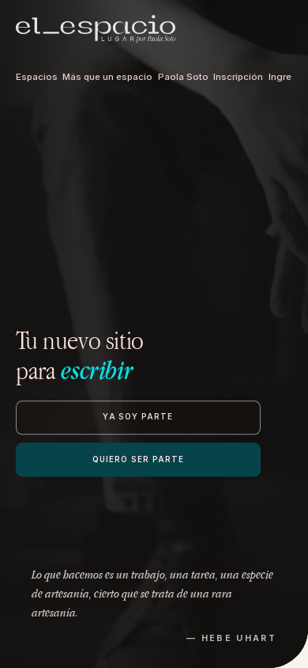
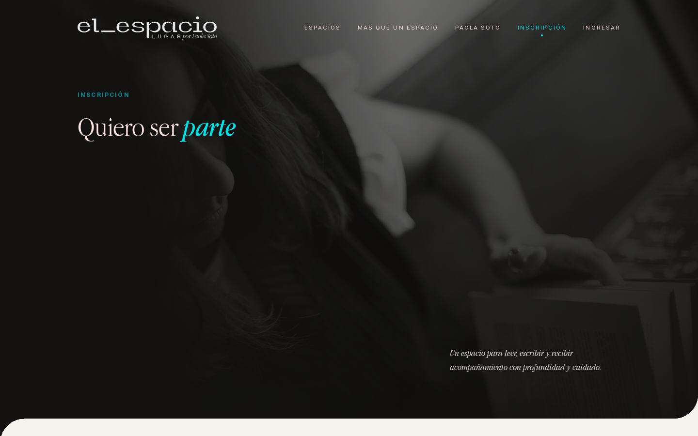
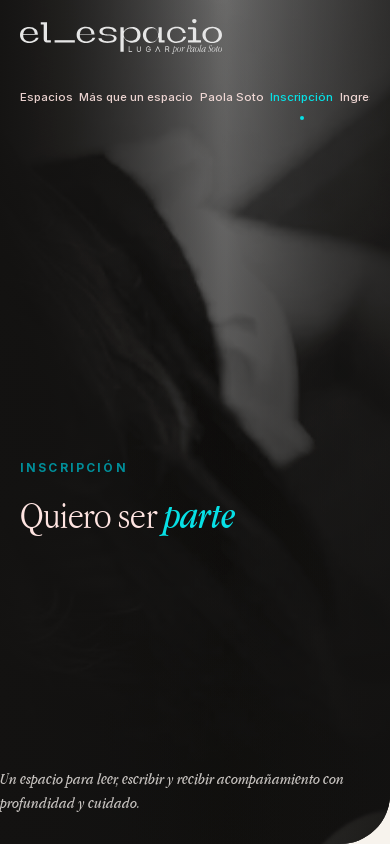

# el_espacio: producto y UX/UI de una web-app editorial para un taller de escritura

**Problema.** El taller "La Poesía de las Cosas" se gestionaba con mensajes, formularios sueltos y pagos manuales. Las alumnas no tenían un lugar propio para las consignas, los encuentros ni sus textos.

**Solución.** Una web-app editorial con sitio público, inscripción con pago, login con Google, validación de alumnas, dashboard con consignas, encuentros, cuaderno y biblioteca, y un panel de administración para la profesora.

**Stack.** Next.js 15 · React 19 · TypeScript · Tailwind CSS · Firebase / Firestore · Stripe · Resend · Vercel

**Mi rol.** Producto y UX/UI de punta a punta: arquitectura de información, flujo de inscripción, diseño visual y las iteraciones con la clienta en ramas dedicadas. Delegué a la IA buena parte de la implementación y validé cada release candidate con checklists de QA y scripts de pago.

**Resultados.**
- En línea en [www.elespaciolugar.com](https://www.elespaciolugar.com). <!-- fuente: WOS/_reports/INVENTARIO_STACK_2026-10.md §8 (HTTP 200, 2026-10-28) -->
- 85 commits entre 2026-05-21 y 2026-10-21. <!-- fuente: WOS/_reports/INVENTARIO_STACK_2026-10.md §3.8 -->
- 4 áreas de la app separadas por grupos de rutas: pública, taller, mentorías y administración. <!-- fuente: WOS/_reports/INVENTARIO_STACK_2026-10.md §3.8 -->
- Rutas públicas verificadas: inicio, inscripción, la profesora y acceso. <!-- fuente: WOS/_reports/INVENTARIO_STACK_2026-10.md §8 -->
- Pagos con Stripe en modo live (ver [caso 05](../05-pagos-stripe-web3/)). <!-- fuente: WOS/_reports/INVENTARIO_STACK_2026-10.md §3.8 -->

## Arquitectura

## Decisiones clave
- **Tono editorial antes que "plataforma"**: tipografía, ritmo y espacio en blanco de libro, para que el taller se sienta íntimo y no como un LMS.
- **Grupos de rutas por audiencia**: el público, las alumnas y la profesora viven en áreas separadas, con reglas de acceso propias.
- **Iteraciones de la clienta en ramas dedicadas**: cada ronda de ajustes visuales se revisa y se integra aparte de las funciones nuevas.

## Qué haría distinto
Sumaría tests de componentes y de reglas de Firestore desde la primera fase, en vez de apoyarme solo en QA manual y en scripts de pago.

## Capturas

> Código privado. Recorrido técnico disponible a pedido.
