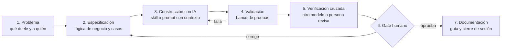

# Método de trabajo con IA: validar antes de confiar, y enseñar a otros a hacerlo

**Problema.** Construir con IA es rápido, pero sin método aparecen alucinaciones, cambios que nadie revisó, secretos expuestos y contexto que se pierde entre sesiones y herramientas. Le pasa a quien empieza y también a quien lleva meses haciéndolo.

**Solución.** Un método propio (Método VOS) que separa con claridad qué hace la IA y qué decide una persona. Se basa en cuatro elementos:
- prompts que son ciclos completos, con puntos de control y condiciones de parada;
- validadores y bancos de prueba automáticos;
- revisión cruzada entre modelos;
- un gate humano que no se delega.

Es el mismo método que uso para acompañar a otras personas cuando empiezan a construir con IA.

**Stack.** Claude Code · Codex · Antigravity · AGENTS.md / CLAUDE.md · skills · Python (validadores, pytest) · git · Obsidian

**Mi rol.** Diseñé el método, sus reglas y sus plantillas. Lo apliqué de punta a punta en una base de conocimiento que consolida más de 150 conversaciones de 5 plataformas de IA, en la migración de infraestructura y en Logicore.

**Resultados.**
- 15 proyectos validados con el mismo proceso de dos fases (inventario y propuesta → gate humano → promoción y validación). <!-- fuente: obsidian_master_memory / BASELINE_STATE.md -->
- 208 elementos registrados y aceptados en el registro de proyectos, cada uno con su decisión. <!-- fuente: PROJECT_REGISTRY.md -->
- Aprobación por lotes: de más de 150 decisiones individuales a unas 16, sin perder control humano. <!-- fuente: PROC-001 -->
- Validadores en Python con pruebas automáticas que detectan pérdidas de datos entre fases. <!-- fuente: _validate_vault_core.py, tests/test_memory_vault.py -->
- Credenciales excluidas desde el origen y comandos destructivos reservados a una persona, por reglas de permisos de los agentes. <!-- fuente: AGENTS.md, ~/.claude/settings.json (estructura) -->

## El roadmap que uso para acompañar a alguien que construye con IA

**Cómo se traduce en el día a día con un usuario:**
- **No siempre hace falta desarrollar.** A veces alcanza con una skill a medida o con buenas prácticas de uso de Claude, Copilot o la herramienta que esa persona ya usa.
- **Si el proceso se repite y tiene reglas claras,** se evalúa llevarlo a un flujo de n8n mantenido por tecnología.
- **Toda idea que la IA "confirma" pasa por un banco de pruebas** con casos conocidos antes de usarse con datos reales. Es el filtro principal contra las alucinaciones.
- **Lo sensible no entra al prompt:** ni secretos, ni datos personales, ni permisos de más.

## Decisiones clave
- **El gate humano no se delega:** ningún agente aprueba su propio trabajo; las aceptaciones, exclusiones y acciones irreversibles son de una persona.
- **Cada sesión cierra con un resumen** (qué se hizo, qué falta, qué decide la persona) para que el contexto no dependa de la memoria de una herramienta.
- **Guardas dinámicas, no números fijos:** los validadores comparan contra un estado base, así detectan pérdidas sin romperse cuando el proyecto crece.

## Qué haría distinto
Empezaría con la plantilla de cierre de sesión desde el primer día. Al principio el contexto vivía disperso en chats y costó recuperarlo.

> Documentación interna privada. Recorrido del método y de sus plantillas disponible a pedido.
