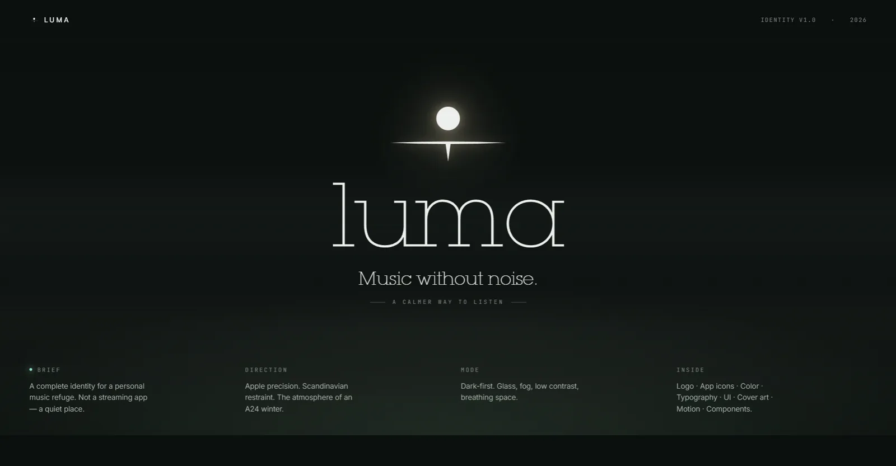
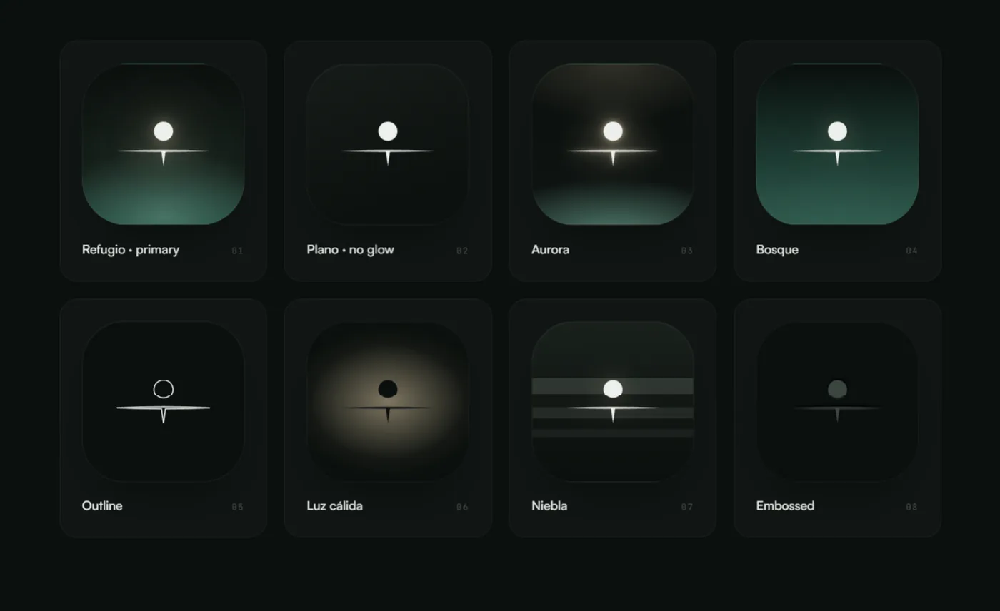

# LUMA: una app de música para Android pensada como refugio, no como feed

**Estado:** app nativa instalada y en uso en mi Android, en evolución hacia la interfaz final. Proyecto propio; código privado.

## El problema
Las apps de música se volvieron feeds: recomendaciones, anuncios y ruido constante. Quien tiene su propia biblioteca (MP3, WAV o producciones propias) no tiene un lugar cuidado para escucharla.

## La propuesta
*"Escuchar música no debería sentirse como consumir contenido."* LUMA es un santuario personal de música local: sin streaming, sin algoritmo y sin nada que compita con lo que suena. El concepto visual es *una cabaña en el bosque, en píxeles*.

## Mi rol
- **Concepto e identidad (míos):**
  - el símbolo: una luz cálida suspendida sobre una línea de horizonte, con 8 variantes de ícono para distintos usos;
  - la paleta de pino, niebla, piedra y una luz cálida;
  - las tipografías y sus reglas: serif para lo humano, sans para lo del sistema;
  - las carátulas tratadas "como clima".
- **Sistema para agentes:** usé Claude Design para ordenar todo lo anterior en un artefacto que los agentes de IA consumen al construir la interfaz, de modo que el código respete la marca sin interpretarla.
- **Desarrollo:** app nativa en Android Studio, construida con Claude Code, Codex y Gemini en Android Studio, en sprints acotados con verificación al cierre de cada uno.

## Lo que hace hoy
| Función | Estado |
|---|---|
| Importación de MP3 y WAV, y de bibliotecas ZIP organizadas por carpetas | Funciona |
| Playlists automáticas por carpeta y biblioteca unificada | Funciona |
| Carátulas reales leídas de cada archivo (ID3) y respaldo determinista con 8 fondos de marca | Funciona |
| Reproducción en segundo plano con MediaSession: controles en la pantalla de bloqueo y en la notificación | Funciona |
| Modo silencioso y espacios ambientales (Fog, Pines, Snow) | Funciona |
| Interfaz final según el sistema visual | En desarrollo |
| Integraciones con plataformas de streaming | En el plan; no se muestran hasta que funcionen |

## Una decisión de producto
Una auditoría con Claude Code, en modo solo lectura, encontró que la primera versión de la interfaz mostraba integraciones con Spotify, Deezer y YouTube que todavía no existían. La corregí con Codex el mismo día. La regla que quedó: **una función que la interfaz promete y no cumple es peor que no tenerla**. Hoy aplico ese mismo criterio a cualquier herramienta que construyo para otros.

## Stack
Kotlin · Jetpack Compose · Media3 / ExoPlayer · MediaSession · Android Studio · Gradle · Gemini en Android Studio · Claude Code · Codex · Claude Design

## Capturas
- Sistema visual: `docs/img/luma-identidad-hero-desktop.webp`, `luma-identidad-ambientes-desktop.webp` y `luma-diseno-pantallas-desktop.webp`.
- Versión actual en el teléfono: `docs/img/luma-build-*.webp`.

