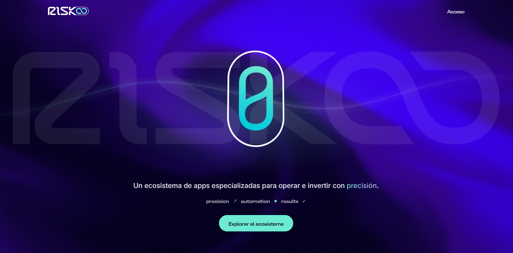
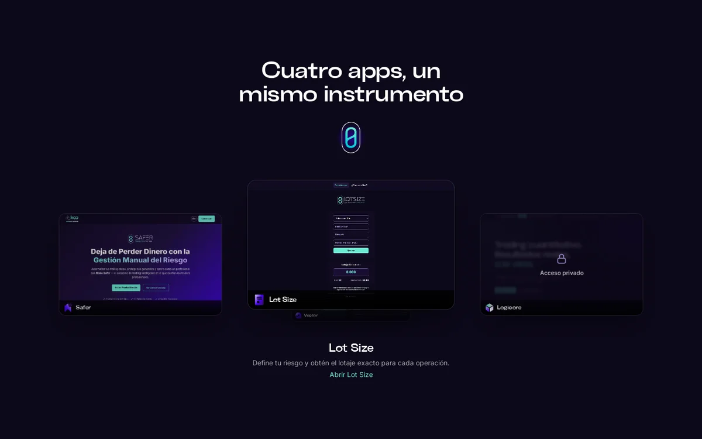

# Risko: un ecosistema de apps especializadas para trading e inversión

**Professional trading tools · precision · automation · results**

## El problema
Quien opera en los mercados trabaja con herramientas sueltas: una calculadora en un sitio, alertas en otro, reportes en una hoja de cálculo y la gestión del riesgo en la cabeza. Nada conversa con nada y cada paso depende de la disciplina manual.

## La propuesta
Un ecosistema donde cada app resuelve un paso de la operación, con una marca, un sistema de íconos y una infraestructura comunes:

| Paso | App | Qué hace | Estado |
|---|---|---|---|
| Calcular el riesgo | **Lot Size** | Calcula el lotaje según el riesgo por operación (Forex, índices, cripto). PWA con login. | En línea · [lotsize.risko.app](https://lotsize.risko.app) |
| Proteger la operación | **Safer** | EA de protección con trailing stops automáticos. Web de venta con login, licencias con TOTP/QR y pago con billeteras Web3 verificado on-chain. | En línea · [safer.risko.app](https://safer.risko.app) |
| Analizar resultados | **Vector** | Análisis de resultados de backtesting de MT5 con métricas de nivel institucional (equity, drawdown, Sharpe). | En línea · [backtest.risko.app](https://backtest.risko.app) |
| Automatizar la inversión | **Logicore** | Inversión automatizada en cripto (bots grid en Pionex), futuros y forex (EAs en MT5 y NinjaTrader), con un motor de backtesting propio. | Acceso privado |

**Landing del ecosistema:** [risko.app](https://risko.app). Diseñada como un instrumento: la cápsula de la marca en el centro, el ecosistema en órbita y un recorrido fijo que presenta cada app como un paso de la operación.

**Sistema de marca:** [system.risko.app](https://system.risko.app). Es un sistema de íconos y wordmark diseñado para todo el ecosistema: la cápsula como símbolo central y un ícono por producto.

## Lo que construí (mi rol)
Producto de punta a punta: estrategia, marca, UX/UI, desarrollo asistido por IA, pagos, infraestructura y operación continua.

- **Producto y marca:** arquitectura del ecosistema, identidad, sistema de íconos, landing y diseño de cada app.
- **Apps:** React y Next.js con Firebase, Supabase y PostgreSQL, según cada caso.
- **Pagos:** licencias con TOTP y QR, y pago con billetera Web3 (Privy + ethers) con verificación on-chain del lado del servidor.
- **Logicore:**
  - colector en Python que consulta los exchanges cada hora;
  - PostgreSQL 16 y un panel en Next.js 16, desplegados con Docker y Coolify;
  - motor de backtesting de unos 25 módulos, con 189 pruebas automatizadas y 2.536 variantes evaluadas con validación fuera de muestra.
- **Construcción con agentes:** Claude Code orquesta a Codex y Antigravity en git worktrees (8 subagentes, 12 skills y un tablero de 17 tareas), con aprobación humana para commits y operaciones en exchanges.
- **Infraestructura:**
  - un VPS 24/7 con Coolify, n8n, PostgreSQL y 10 instancias de MT5 headless, con monitoreo y alertas por Telegram;
  - un segundo VPS dedicado a la orquestación de agentes de IA.

## Por qué importa
Es un dominio donde un error cuesta dinero real. Por eso hay reglas que se repiten en todo el ecosistema:
- gestión de riesgo antes que rentabilidad;
- automatización con control humano;
- validación fuera de muestra antes de usar una estrategia;
- herramientas de IA que, por diseño, no pueden enviar órdenes reales (ver el caso de servidores MCP).

## Capturas

## Casos relacionados
- [Logicore + orquestación multiagente](../04-logicore-multiagente/)
- [Pagos: Stripe y Web3](../05-pagos-stripe-web3/)
- [Monitoreo 24/7 con n8n](../01-monitoreo-mt5-n8n/)
- [Servidores MCP](../03-servidores-mcp/)
- [Migración de infraestructura](../02-migracion-infraestructura/)

> No se publican parámetros de estrategias, saldos ni resultados de cuentas. Código privado; recorrido técnico disponible a pedido.
